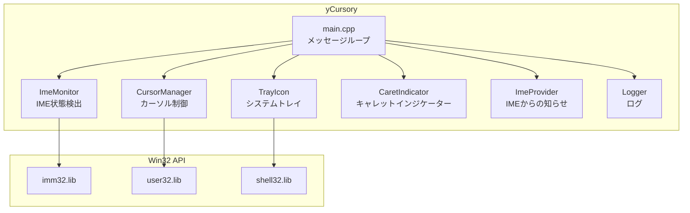
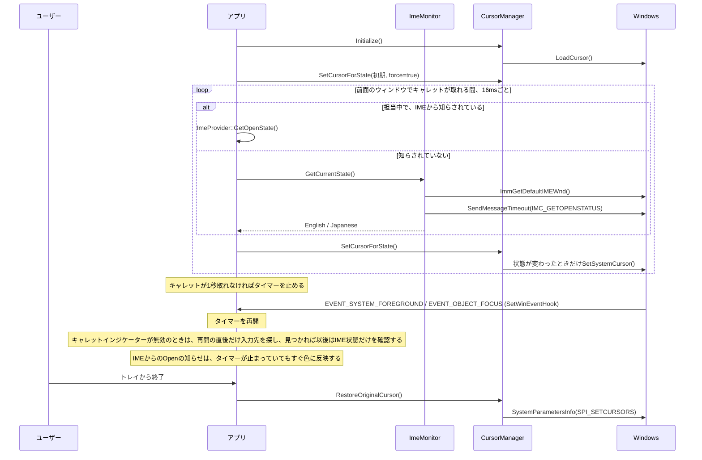
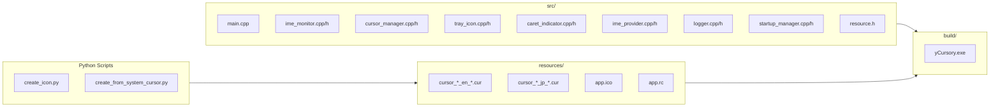
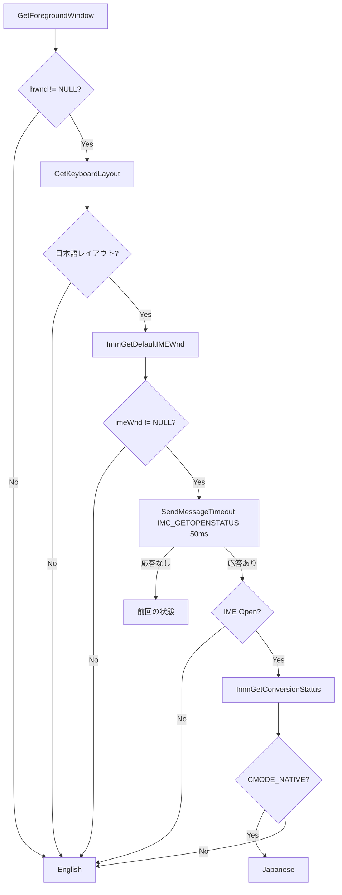
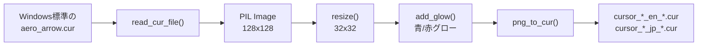
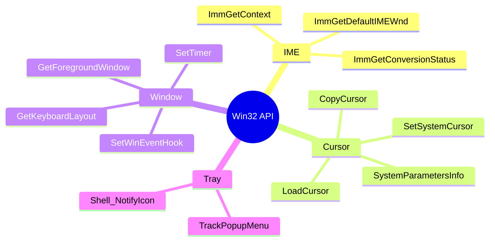

# yCursory - プロジェクト概要

> IME状態をカーソルのグロー色で表示する軽量Windowsツール

## アーキテクチャ

## 動作フロー

## ファイル構成

## IME状態検出ロジック

## カーソル生成フロー

## 主要API

## スペック

| 項目 | 値 |
|------|-----|
| EXE | 約380KB |
| ポーリング | 16ms。キャレットが取れるウィンドウが前面にある間だけ動く。キャレットが1秒取れなければ止まり、ウィンドウかフォーカスの切り替えで再開する |
| カーソルサイズ | 32x32 |
