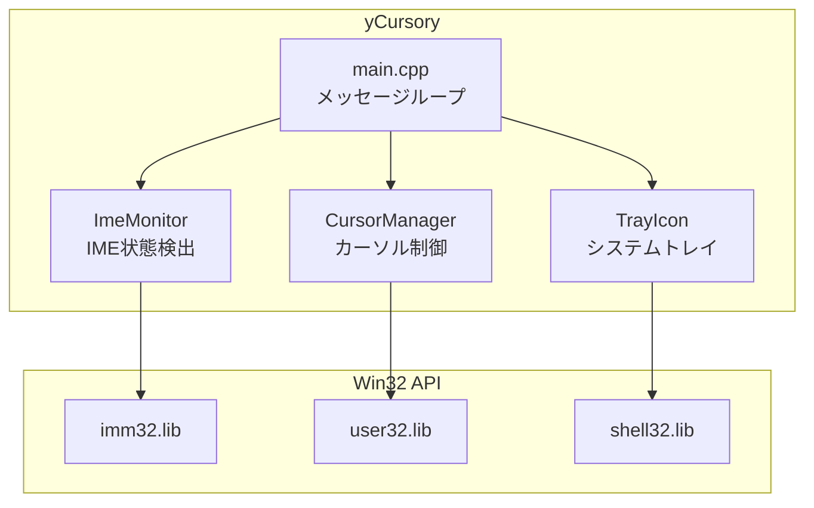
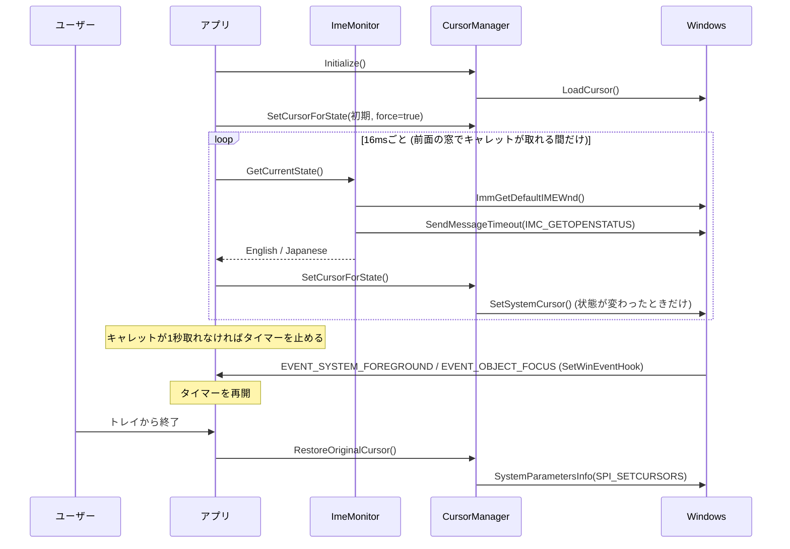
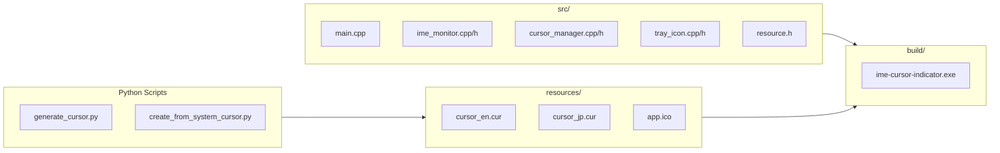
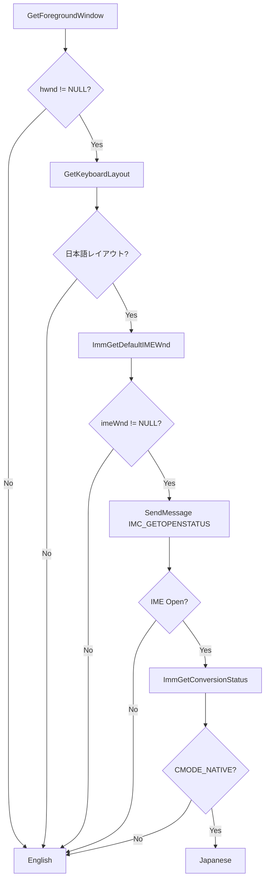
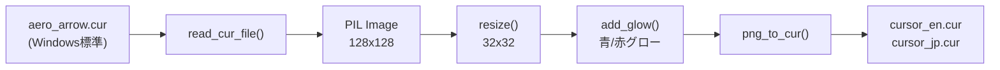
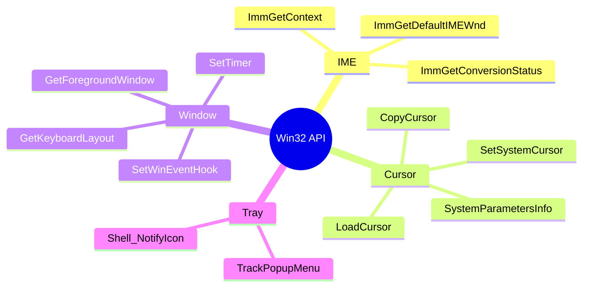

# yCursory - プロジェクト概要

> IME状態をカーソルのグロー色で表示する軽量Windowsツール

## アーキテクチャ

## 動作フロー

## ファイル構成

## IME状態検出ロジック

## カーソル生成フロー

## 主要API

## スペック

| 項目 | 値 |
|------|-----|
| EXE | 約120KB |
| メモリ | 約1.4MB |
| ポーリング | 16ms (キャレットが取れる窓が前面の間だけ。取れなければ 1 秒で止まり、窓・フォーカスの切り替えで再開) |
| カーソルサイズ | 32x32 |
